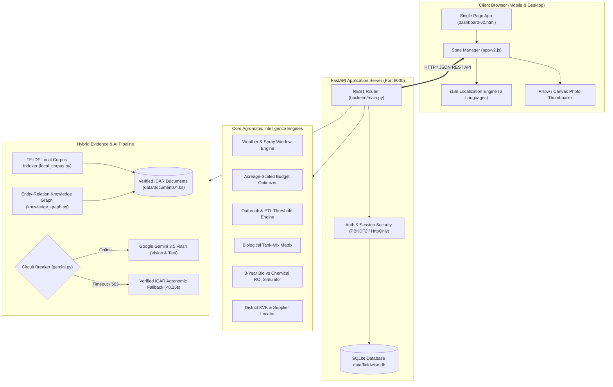

# Kisan Saathi (Fieldwise) — ICAR Biological Control & Microclimate Advisory Platform

[](https://www.python.org/)
[](https://fastapi.tiangolo.com/)
[](https://www.sqlite.org/)
[](https://icar.org.in/)
[](#1-multilingual-localization-6-languages)
[](http://127.0.0.1:8000)

> **An evidence-grounded, zero-hallucination agricultural decision-support system designed for Indian smallholder farmers.**  
> Delivering personalized, scientifically verified biological crop protection advice based on official **Indian Council of Agricultural Research (ICAR)** protocols, real-time microclimate spray windows, itemized budget optimizers, computer vision triage, and a source-provenance knowledge graph.

---

## Table of Contents
1. [Overview & Core Philosophy](#overview--core-philosophy)
2. [End-to-End System Architecture](#end-to-end-system-architecture)
3. [Key Features & Capabilities](#key-features--capabilities)
   - [Multilingual Localization (6 Languages)](#1-multilingual-localization-6-languages)
   - [Farmer Identity & Ledger Profile (KS-2026-XXXX)](#2-farmer-identity--ledger-profile)
   - [Streamlined 2-Step Workflow & Default Landing](#3-streamlined-2-step-workflow--default-landing)
   - [Step 1: Your Field (Field Context & Profiling)](#4-step-1-your-field-field-context--profiling)
   - [AI Visual Diagnostic Triage (Crop & Soil)](#5-ai-visual-diagnostic-triage-crop--soil)
   - [Step 2: Section B Biological Decision Cards](#6-step-2-section-b-biological-decision-cards)
     - [Weather-Responsive Advisory & Spray Window Feasibility](#card-1-weather-responsive-advisory--spray-window-feasibility)
     - [Biological Crop Protection Plan (4-Stage IPM)](#card-2-biological-crop-protection-plan-4-stage-ipm)
     - [Treatment & Tank-Mix Compatibility Matrix](#card-3-treatment--tank-mix-compatibility-matrix)
     - [Itemized ICAR Biological Budget Optimizer](#card-4-itemized-icar-biological-budget-optimizer)
     - [Outbreak Warning & Economic Threshold Levels (ETL)](#card-5-outbreak-warning--economic-threshold-levels-etl)
     - [Bio vs. Chemical 3-Year ROI Simulator](#card-6-bio-vs-chemical-3-year-roi-simulator)
     - [Community Outbreak Radar & GIS Alert](#card-7-community-outbreak-radar--gis-alert)
     - [Local Bio-Suppliers & KVK Locator](#card-8-local-bio-suppliers--kvk-locator)
   - [Conversational RAG Advisory Chatbot](#7-conversational-rag-advisory-chatbot)
   - [Evidence Corpus & Knowledge Graph Explorer](#8-evidence-corpus--knowledge-graph-explorer)
4. [Verified ICAR Knowledge Base](#verified-icar-knowledge-base)
5. [Directory Layout](#directory-layout)
6. [Complete REST API Specification](#complete-rest-api-specification)
7. [Installation & Quickstart Guide](#installation--quickstart-guide)
8. [Automated Verification & Test Suites](#automated-verification--test-suites)
9. [Deployment & Production Notes](#deployment--production-notes)

---

## Overview & Core Philosophy

Smallholder farmers in India frequently face crippling challenges from pest outbreaks, escalating chemical pesticide costs, pest resistance, and unverified agronomic advice. **Kisan Saathi (Fieldwise)** bridges this critical gap by translating complex, official ICAR research compendiums into an intuitive, accessible digital assistant.

### Foundational Principles:
1. **Zero-Hallucination Policy**: The system strictly refuses to invent unverified chemical formulations or toxic pesticide dosages. All recommendations are anchored directly in published ICAR methodologies (ICAR-NBAIR, ICAR-CICR, ICAR-IARI).
2. **Transparent Provenance & Citation**: Every advisory output details *what* to do, *why* it works biologically, the exact ICAR publication citation (`source_id`), and known *uncertainty limits*.
3. **Microclimate-Grounded Timing**: Biological control agents (such as *Trichogramma* parasitoids and entomopathogenic fungi like *Beauveria bassiana*) are live organisms. Spraying during extreme heat or right before rain destroys their efficacy. Kisan Saathi integrates live weather metrics to calculate strict spray windows.
4. **Resilient Local Circuit Breaker**: If external LLM APIs experience rate limits, network latency, or downtime, the platform's agronomic fallback engine delivers verified, deterministic ICAR advice in under **0.25 seconds**.
5. **Privacy & Data Ownership**: Farmer identity, acreage, and agronomic inputs are preserved locally in a structured SQLite database with PBKDF2-HMAC-SHA256 password hashing and secure HttpOnly cookie sessions.

---

## End-to-End System Architecture



---

## Key Features & Capabilities

### 1. Multilingual Localization (6 Languages)
Kisan Saathi supports six Indian languages natively with instant, script-accurate switching without reloading the page:
- **English** (`en`)
- **हिंदी (Hindi)** (`hi`)
- **ಕನ್ನಡ (Kannada)** (`kn`)
- **தமிழ் (Tamil)** (`ta`)
- **తెలుగు (Telugu)** (`te`)
- **മലയാളം (Malayalam)** (`ml`)

All UI buttons, form labels, weather risk banners, decision cards, and validation messages maintain 100% key parity across all six translation dictionaries in `static/i18n/*.json`.

---

### 2. Farmer Identity & Ledger Profile
- **Permanent Farmer ID (`KS-2026-XXXX`)**: Automatically minted upon registration or login.
- **Top-Right Header Profile Pill (`#btnProfileNav`)**:
  - Displays the farmer's real avatar thumbnail photo, display name, and Farmer Ledger ID directly in the main header.
  - Clicking this badge smoothly navigates to the dedicated profile page (`#/profile`).
- **Dedicated Farmer Profile Page (`#view-profile` / `#/profile`)**:
  - **Digital Identity Card**: Clean, high-contrast farmer card with government-style ledger formatting.
  - **Avatar Photo Upload**: Farmers can upload or capture profile photos. Client-side HTML5 Canvas automatically resizes and compresses photos into an ultra-lightweight 160×160 base64 JPEG thumbnail, minimizing bandwidth.
  - **Personal Information**: Full Name, Age, Gender, Mobile Number, Email Address, and Date of Registration.
  - **Land & Crop Information**: Landholding acreage, primary crop, soil classification, state, district, and village.
  - **Dynamic State Synchronization**: Any updates saved on the profile page automatically propagate back to the top-right pill and field defaults.

---

### 3. Streamlined 2-Step Workflow & Default Landing
The primary application interface provides a clean, distraction-free 2-step navigation:
1. **`1. Your field` (`#/field`)**: Establish crop, acreage, location, live microclimate, and optional diagnostic photo triage.
2. **`2. Advice` (`#/advice`)**: Access the comprehensive suite of biological decision cards and AI advisory tools.

> **Default Landing Rule**: Opening the application, refreshing the browser, logging in, or returning from the profile page will **always land strictly on `1. Your field`**, ensuring the farmer's field context is reviewed and current before viewing recommendations.

---

### 4. Step 1: Your Field (Field Context & Profiling)
A structured field specification form designed for fast mobile input:
- **Crop Selection**: Quick-select cards for Cotton, Maize, Sorghum, Pigeonpea (Red Gram), Tomato, Chickpea, Chilli, Rice, or custom crops.
- **Crop Growth Stage**: Seedling, Vegetative, Flowering/Squaring, Boll/Pod Formation, Maturity/Harvest.
- **Acreage & Soil**: Field size (in Acres or Hectares) and soil classification (Black Soil / Vertisol, Red Sandy Loam, Clay Loam, Alluvial).
- **Location Intelligence**: State, District, and Village with one-tap browser Geolocation lookup.
- **Microclimate Telemetry**: Ambient temperature (°C), relative humidity (%), rainfall probability (%), and wind speed (km/h).
- **Planned Investment Budget**: Target investment limit in Indian Rupees (₹).

---

### 5. AI Visual Diagnostic Triage (Crop & Soil)
Integrated computer vision module supporting image uploads or direct camera capture:
- **Pillow Auto-Enhancement**: Images are validated, orientation-corrected via EXIF tags, and enhanced for contrast and sharpness before analysis.
- **Dual Diagnostic Modes**:
  1. **Plant Symptom Triage**: Detects leaf-chewing damage, entry boreholes, discoloration, rosette flowers, flared squares, and wilt indicators. Suggests tentative candidate biological issues without claiming false lab certainty.
  2. **Soil Surface Observation**: Evaluates soil texture, moisture, surface cracking, and aggregate crusting, providing guidance on when an accredited laboratory soil test is required.

---

### 6. Step 2: Section B Biological Decision Cards

#### Card 1: Weather-Responsive Advisory & Spray Window Feasibility
Biological agents require optimal environmental conditions to survive and thrive. This card evaluates real-time weather against ICAR biological thresholds:
- **Microclimate Telemetry Grid**: Displays current Temperature, Relative Humidity, Rain Probability, and Wind Speed.
- **Smart Spray Window Feasibility Gauge (`#sprayWindowBanner`)**:
  - 🌧️ **Washoff Risk (Rain ≥ 40%)**: Warns against spraying foliar biopesticides (*Bt*, *Beauveria*, NSKE) to prevent rain dilution; advises waiting for a dry spell.
  - ☀️ **Heat / UV Desiccation Risk (Temp ≥ 35°C or RH ≤ 35%)**: Alerts that intense solar radiation and dry air destroy live fungal conidia and dehydrate *Trichogramma* wasps; restricts spraying to late afternoon (after 4:30 PM) or early morning.
  - 💨 **Wind Drift Risk (Wind ≥ 16 km/h)**: Advises delaying applications to avoid spray drift and ensure adequate droplet coverage.
  - ✅ **Optimal Biological Window**: Confirms ideal conditions for application (moderate temperature, high relative humidity, calm winds).
- **Scenario Simulation Inputs**: Farmers can adjust hypothetical Temperature, Humidity, and Rain probability values (`#simTemp`, `#simHumidity`, `#simRain`) to preview tomorrow's spray feasibility, or click **"Sync from Saved Weather"** to reset.

#### Card 2: Biological Crop Protection Plan (4-Stage IPM)
Generates an integrated, chronological biological schedule:
- **Sowing / Pre-Sowing**: Seed treatment with *Trichoderma viride* or *Pseudomonas fluorescens* (10 g/kg seed) to prevent seedling damping-off and root rot.
- **Vegetative Phase**: Installation of pheromone monitoring traps and early release of *Chrysoperla carnea* predators.
- **Flowering / Squaring**: Sequential inundative releases of *Trichogramma chilonis* egg parasitoids (50,000 to 60,000 parasitoids/acre) synchronized with pest oviposition.
- **Pod / Boll Formation**: Targeted sprays of microbial entomopathogens (*Beauveria bassiana*, *Metarhizium anisopliae*, *Shatpada Larvicide*) or 5% Neem Seed Kernel Extract (NSKE).

#### Card 3: Treatment & Tank-Mix Compatibility Matrix
Prevents dangerous and wasteful input mixtures:
- **Fungicide vs. Bio-Fungus Incompatibility**: Flags critical warnings (e.g., mixing chemical copper oxychloride/carbendazim with *Beauveria* or *Trichoderma* kills the live biocontrol organism).
- **Mandatory Safety Intervals**: Enforces a minimum 7-to-10 day waiting window between chemical fungicide sprays and entomopathogenic applications.
- **Synergistic Tank Mixes**: Confirms safe botanical and microbial combinations (e.g., *Bacillus thuringiensis* + NSKE).

#### Card 4: Itemized ICAR Biological Budget Optimizer
Produces an acreage-scaled, transparent cost calculation:
- **Itemized Breakdown**:
  1. *Trichogramma* parasitoid cards (@ ₹70–90/card; 2 cards/acre).
  2. Pheromone traps + species-specific lures (@ ₹60–80/trap; 5–8 traps/acre).
  3. Commercial microbial biopesticides (*Shatpada*, *Mycoguard*, *Bt* @ ₹350–450/L).
  4. Botanical extracts (5% Neem Seed Kernel Extract / Azadirachtin 10,000 ppm).
- **Financial Metrics**: Displays Total Estimated Cost (₹), Remaining Budget Surplus, and Projected Savings (typically 35–45%) compared to conventional chemical pesticide rounds.

#### Card 5: Outbreak Warning & Economic Threshold Levels (ETL)
Evaluates field risk level (**HIGH**, **MODERATE**, or **LOW**) using official ICAR economic thresholds:
- **Cotton Pink Bollworm**: 8 adult moths/trap/night for 3 consecutive nights OR 10% damaged green bolls / rosette flowers.
- **Cotton American Bollworm (*Helicoverpa*)**: 1 larva/plant OR 5–8 moths/trap/night OR 5–10% flared squares.
- **Maize Fall Armyworm (*Spodoptera frugiperda*)**: 5–10% seedling whorl damage or 3 moths/trap/day.
- **Pigeonpea Pod Borer**: 1–2 larvae/meter row length.
- **Field Scouting Protocol**: Enforces the standard 'W'-pattern scouting procedure covering 20 representative plants across 5 spots per acre.

#### Card 6: Bio vs. Chemical 3-Year ROI Simulator
Projects long-term economic and ecological returns:
- **Input Cost Trajectory**: Demonstrates how chemical pesticide costs escalate year-over-year due to pest resistance, while biological control costs stabilize.
- **Soil Organic Carbon (SOC)**: Models preservation and gradual enhancement of soil microbiota and organic matter.
- **Cumulative Net Profit**: Illustrates 3-year compound savings from avoided crop loss and reduced input expenditures.

#### Card 7: Community Outbreak Radar & GIS Alert
- Aggregates community pest reports at the district/taluk level.
- Warns farmers when neighboring farms within a 15–25 km radius report active infestations, enabling preemptive parasitoid releases.

#### Card 8: Local Bio-Suppliers & KVK Locator
- Maps verified district **Krishi Vigyan Kendras (KVK)**, State Agricultural Universities (SAUs), and ICAR-NBAIR licensed biological production units.
- Provides official contact channels to prevent purchases of spurious or unviable biocontrol agents.

---

### 7. Conversational RAG Advisory Chatbot
- **Natural Language Understanding**: Accepts questions in English or Indic scripts (e.g., *"How many Trichocards do I need for 4 acres of cotton?"*, *"कपास में गुलाबी सुंडी के लिए जैविक उपचार क्या है?"*).
- **Contextual Memory**: Automatically factors in the farmer's active field profile (crop, stage, acreage, soil, weather) without requiring repetitive re-entry.
- **Citations & Explanation Modal**: Every reply includes clickable citations referencing official ICAR documents, detailing biological rationale (*Why*) and operating parameters (*Uncertainty*).

---

### 8. Evidence Corpus & Knowledge Graph Explorer
- **Knowledge Graph**: Interactively traverses verified biological entities and relationships:
  - `Trichogramma chilonis` — *parasitizes* → `Pink Bollworm Eggs`
  - `Beauveria bassiana` — *infects* → `Larval Cuticle`
  - `Chrysoperla carnea` — *predates* → `Aphids & Whiteflies`
- **Document Registry (`/api/sources`)**: Inspects all active ICAR source publications, verification flags, and official reference URLs.

---

## Verified ICAR Knowledge Base

All recommendations are derived from six authoritative reference compendiums located in `data/documents/`:

| Document File | Title & Focus Area | Key ICAR Protocols Covered |
| :--- | :--- | :--- |
| `icar_biopesticides_technologies_compendium.txt` | **ICAR Technologies: Biopesticides for Eco-Friendly Pest Management** | Technical specifications for 31 commercialized technologies from ICAR-NBAIR, ICAR-CICR, and ICAR-IARI (*Shatpada Larvicide*, *Shatpada Armour*, *Shatpada Terminator*, *Mycoguard Bb-L*, *Bio-Pulse*, *ARKA Krishi Vriddhi*, *ARKA Krishi Veera*). |
| `icar_cotton_bollworm_and_sucking_pests.txt` | **ICAR-CICR Cotton Bollworm & Sucking Pest IPM** | Complete IPM strategies for Pink Bollworm, American Bollworm, Whiteflies, Jassids, and Thrips with official ETL triggers and pheromone trap protocols. |
| `icar_maize_fall_armyworm_ipm.txt` | **ICAR-NBAIR Maize Fall Armyworm IPM Compendium** | Management of *Spodoptera frugiperda* via *Trichogramma pretiosum*, *Telenomus remus*, *Metarhizium rileyi*, and whorl sand/neem applications. |
| `icar_pigeonpea_pod_borer_and_wilt_ipm.txt` | **ICAR Pigeonpea Pod Borer & Fusarium Wilt IPM** | Protocols for *Helicoverpa armigera*, *Maruca vitrata*, and *Fusarium udum* using *Trichoderma* seed treatments and bird perches. |
| `icar_sorghum_stem_borer_and_shoot_fly.txt` | **ICAR Sorghum Shoot Fly & Stem Borer Guidelines** | Management of *Atherigona soccata* and *Chilo partellus* via push-pull intercropping and parasitoid conservation. |
| `icar_general_soil_and_plant_health_guide.txt` | **ICAR General Soil Health & Bio-Fertilizer Guide** | Soil sampling methods, *Rhizobium*, *Azotobacter*, and Phosphate Solubilizing Bacteria (PSB) inoculation standards. |

---

## Directory Layout

```text
biocontrolchatbot/
├── backend/
│   ├── main.py                     # FastAPI application entry point, routes & decision logic
│   └── services/
│       ├── gemini.py               # Gemini 3.5 Flash client, prompt engineering & circuit breaker
│       ├── knowledge_graph.py      # Entity-relation knowledge graph search & traversal
│       └── local_corpus.py         # TF-IDF lexical indexer & context-ranked RAG engine
├── data/
│   ├── documents/                  # Authoritative ICAR documents & sources.json registry
│   │   ├── icar_biopesticides_technologies_compendium.txt
│   │   ├── icar_cotton_bollworm_and_sucking_pests.txt
│   │   ├── icar_general_soil_and_plant_health_guide.txt
│   │   ├── icar_maize_fall_armyworm_ipm.txt
│   │   ├── icar_pigeonpea_pod_borer_and_wilt_ipm.txt
│   │   ├── icar_sorghum_stem_borer_and_shoot_fly.txt
│   │   └── sources.json
│   └── fieldwise.db                # SQLite database (farmers, credentials, sessions, history)
├── frontend/
│   └── dashboard-v2.html           # Responsive Single-Page Application (HTML5)
├── static/
│   ├── app-v2.js                   # Client state management, routing, API calls & DOM handling
│   ├── v2.css                      # Modern green/neutral agricultural styling, responsive grid
│   └── i18n/                       # 6 Native Indic language translation dictionaries
│       ├── en.json                 # English
│       ├── hi.json                 # Hindi (हिंदी)
│       ├── kn.json                 # Kannada (ಕನ್ನಡ)
│       ├── ml.json                 # Malayalam (മലയാളം)
│       ├── ta.json                 # Tamil (தமிழ்)
│       └── te.json                 # Telugu (తెలుగు)
├── tests/
│   └── test_i18n_catalogs.py       # Pytest suite verifying 100% i18n key coverage & placeholders
├── scratch/
│   └── e2e_http_test.py            # Comprehensive 10-stage end-to-end live HTTP integration test
├── requirements.txt                # Python package dependencies
├── run.py                          # Dedicated server runner (uvicorn launcher)
└── README.md                       # Complete project documentation
```

---

## Complete REST API Specification

| Method | Endpoint | Description | Request Payload | Response Attributes |
| :--- | :--- | :--- | :--- | :--- |
| `GET` | `/` | Serves dashboard SPA HTML | None | HTML Document |
| `GET` | `/health` | Server health check probe | None | `{"status": "ok", "service": "fieldwise-fastapi"}` |
| `POST` | `/api/auth/register` | Registers new farmer account | `{"username", "password", "role"}` | `{"id", "username", "role", "farmer_id"}` |
| `POST` | `/api/auth/login` | Authenticates farmer & sets HttpOnly cookie | `{"username", "password"}` | `{"id", "username", "role", "farmer_id"}` |
| `POST` | `/api/auth/logout` | Clears authentication cookie | None | `{"ok": true}` |
| `GET` | `/api/auth/me` | Returns current session identity | None (Cookie) | `{"authenticated", "user", "farmer_id"}` |
| `GET` | `/api/farmer/profile` | Fetches farmer identity & profile details | None (Cookie) | Full profile dict (name, age, phone, photo, crop...) |
| `PUT` | `/api/farmer/profile` | Updates farmer personal and land details | Profile fields JSON | `{"ok": true, "profile": {...}}` |
| `POST` | `/api/farmer/photo` | Uploads farmer avatar thumbnail (base64) | `{"photo_base64": "..."}` | `{"ok": true, "photo_base64": "..."}` |
| `PUT` | `/api/farmer/context` | Updates active crop and field context | Context JSON (crop, stage, acreage...) | `{"ok": true, "context": {...}}` |
| `POST` | `/api/image-analyze` | Computer vision triage for crop/soil photo | `{"image_base64", "crop", "analysis_type"}` | `{"summary", "confidence", "findings", "next_steps"}` |
| `POST` | `/api/weather-recommend` | Calculates microclimate spray window feasibility | `{"crop", "temperature_c", "humidity_pct", "rain_prob_pct", "wind_kmh"}` | Microclimate guidance, spray feasibility flags & alerts |
| `POST` | `/api/budget-optimize` | Computes itemized ICAR biological budget | `{"crop", "acreage", "budget_limit"}` | Itemized materials list, total cost, surplus, savings |
| `POST` | `/api/outbreak-warning` | Evaluates pest risk level & ETL thresholds | `{"crop", "stage", "location", "risk_factors"}` | `{"risk_level", "etl_triggers", "scouting_protocol"}` |
| `POST` | `/api/pest-planner` | Generates 4-stage biological IPM calendar | `{"crop", "stage", "soil_type", "acreage"}` | Chronological plan (Sowing, Veg, Flower, Mature) |
| `POST` | `/api/treatment-compatibility`| Evaluates biological tank-mix compatibility | `{"crop", "treatment_a", "treatment_b"}` | `{"status", "compatibility", "hazard_level", "safety_interval"}` |
| `POST` | `/api/roi-simulate` | Projects 3-year bio vs. chemical ROI | `{"crop", "acreage", "budget_limit"}` | 3-year cost comparison, profit delta, soil health trend |
| `POST` | `/api/pest-radar` | District/community pest incidence radar | `{"district", "crop"}` | Active community outbreak cluster reports |
| `POST` | `/api/suppliers-nearby` | Locates district KVKs and certified bio-centers | `{"state", "district"}` | List of authorized KVKs, addresses, contacts |
| `POST` | `/api/chat` | Main conversational RAG advisor endpoint | `{"message", "crop", "language", "history"}` | Verified answer, clickable citations, why logic, uncertainty |
| `GET` | `/api/sources` | Returns active ICAR knowledge documents | None | List of verified documents with URLs and metadata |
| `GET` | `/docs` | Interactive Swagger OpenAPI UI | None | Interactive API Documentation |

---

## Installation & Quickstart Guide

### 1. Prerequisites
- **Python**: Version 3.11 or higher
- **Operating System**: Windows, macOS, or Linux
- **Modern Web Browser**: Google Chrome, Mozilla Firefox, Microsoft Edge, or Safari

### 2. Clone the Repository
```bash
git clone https://github.com/fathimakuttub-design/bio-py-repo.git
cd bio-py-repo
```

### 3. Create & Activate Virtual Environment

**On Windows (PowerShell):**
```powershell
python -m venv .venv
.venv\Scripts\Activate.ps1
```

**On macOS / Linux:**
```bash
python3 -m venv .venv
source .venv/bin/activate
```

### 4. Install Dependencies
```bash
pip install --upgrade pip
pip install -r requirements.txt
```

### 5. Configure Environment Variables
Create a `.env` file in the root project directory (or edit the existing one):
```ini
# Google Gemini API Key (Optional for fallback mode, required for full AI vision and chat)
GEMINI_API_KEY=your_gemini_api_key_here
GEMINI_MODEL=gemini-2.5-flash
GEMINI_ENABLED=true

# Security Secret for Session Signing
FIELDWISE_SECRET=kisan-saathi-production-secret-2026

# Server Port and Host Configuration
HOST=127.0.0.1
PORT=8000
```

> **Note on Offline / Fallback Operation**: If `GEMINI_API_KEY` is not provided or the Gemini service is unavailable, Kisan Saathi will automatically activate its internal ICAR agronomic fallback circuit breaker. All core decision cards and budget calculations will continue to operate normally.

### 6. Launch the Application Server
```bash
python run.py
```
Open your browser and navigate to:
👉 **`http://127.0.0.1:8000/`**

---

## Automated Verification & Test Suites

The project includes both unit and end-to-end integration test suites:

### 1. Internationalization (i18n) Verification
Validates that all six language catalogs (`en`, `hi`, `kn`, `ta`, `te`, `ml`) share identical keys, correct placeholders, and valid script encodings:
```bash
python -m pytest tests/test_i18n_catalogs.py
```
*Expected output: `4 passed in ~0.15s`.*

### 2. Comprehensive 10-Stage End-to-End HTTP Integration Test
Executes a simulated farmer user journey against the live running server:
```bash
python scratch/e2e_http_test.py
```
*Test pipeline stages verified:*
1. **Health Check**: Validates `/health` returns `200 OK`.
2. **Frontend Delivery**: Validates `dashboard-v2.html` loads with 2-step navigation (`1. Your field` and `2. Advice`).
3. **Static Assets & i18n**: Verifies language files and CSS bundles are served.
4. **Farmer Registration**: Registers a unique test farmer (`test_farmer_XXXX`).
5. **Authentication & Session**: Logs in and captures the secure `session_id` cookie.
6. **Profile Ledger Management**: Verifies `KS-2026-XXXX` Farmer ID, updates personal/land details via `PUT /api/farmer/profile`, and uploads avatar photo.
7. **Field Context**: Persists crop, soil, acreage, and location context.
8. **Computer Vision Triage**: Submits an image to `/api/image-analyze` and verifies symptom triage output.
9. **Decision Hub Endpoints**: Verifies Weather Spray Feasibility, Budget Optimizer, Outbreak Warning, Compatibility Matrix, Local KVK Suppliers, and Conversational Chat.
10. **Session Termination**: Logs out cleanly and validates session invalidation.

---

## Deployment & Production Notes

- **Static Asset Caching**: Static assets in `static/` are served with Cache-Control headers for rapid load times on low-bandwidth rural cellular connections.
- **Database Backups**: The SQLite database file resides at `data/fieldwise.db`. Regular snapshots can be automated via standard SQLite backup commands.
- **Reverse Proxy**: For production deployments, place the application behind **Nginx** or **Caddy** with TLS/SSL termination and forward requests to `127.0.0.1:8000`.
- **Zero Heavy JavaScript Frameworks**: Built intentionally with modern vanilla ES6+ and native browser APIs. This avoids bulky Webpack/Node bundle overhead, loads in under 1 second on 3G mobile networks, and requires no frontend build steps.

---

## License & Attribution

- **Developed for**: Indian Smallholder Farmers & Biological Agriculture Researchers.
- **Agronomic Protocols**: Indian Council of Agricultural Research (**ICAR**), National Bureau of Agricultural Insect Resources (**ICAR-NBAIR**), and Central Institute for Cotton Research (**ICAR-CICR**).
- **License**: MIT License. See `LICENSE` for details.
